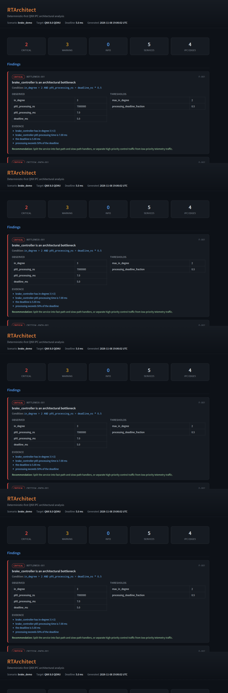
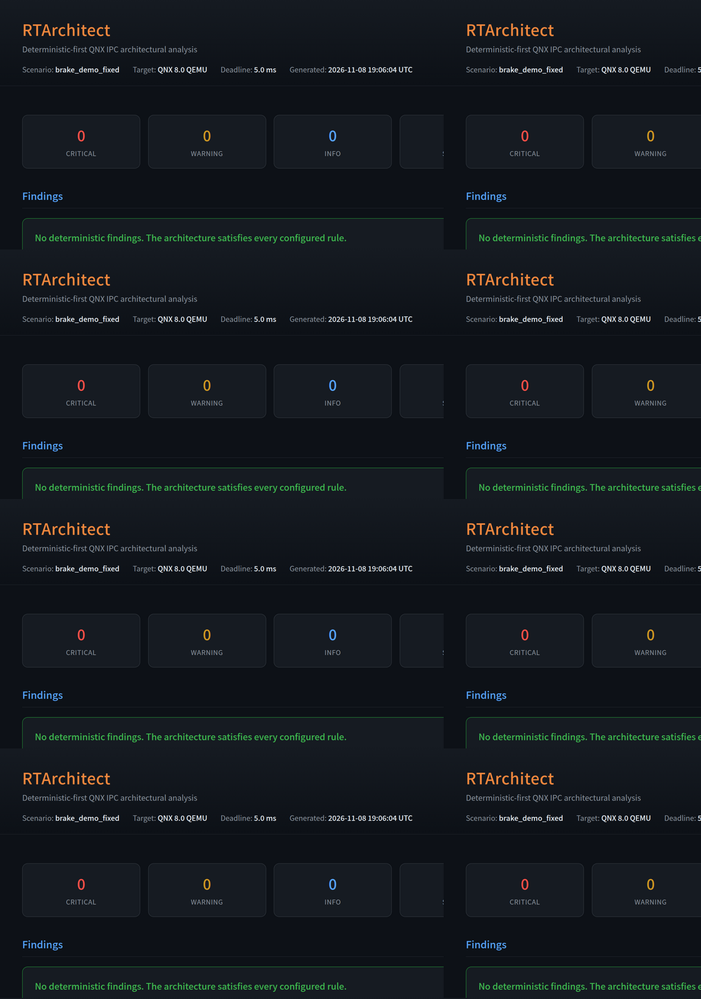
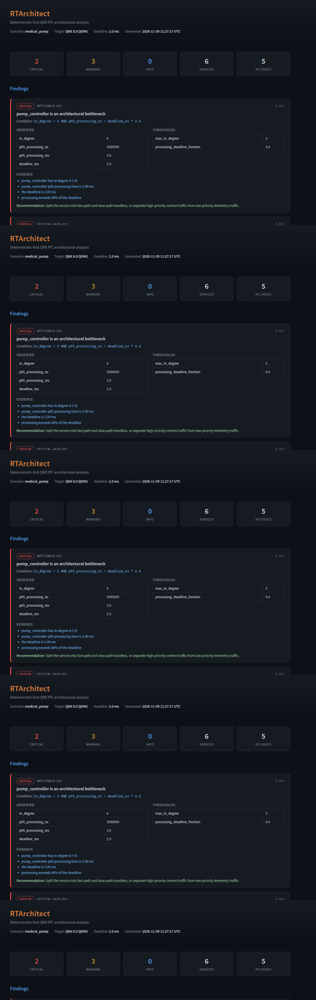
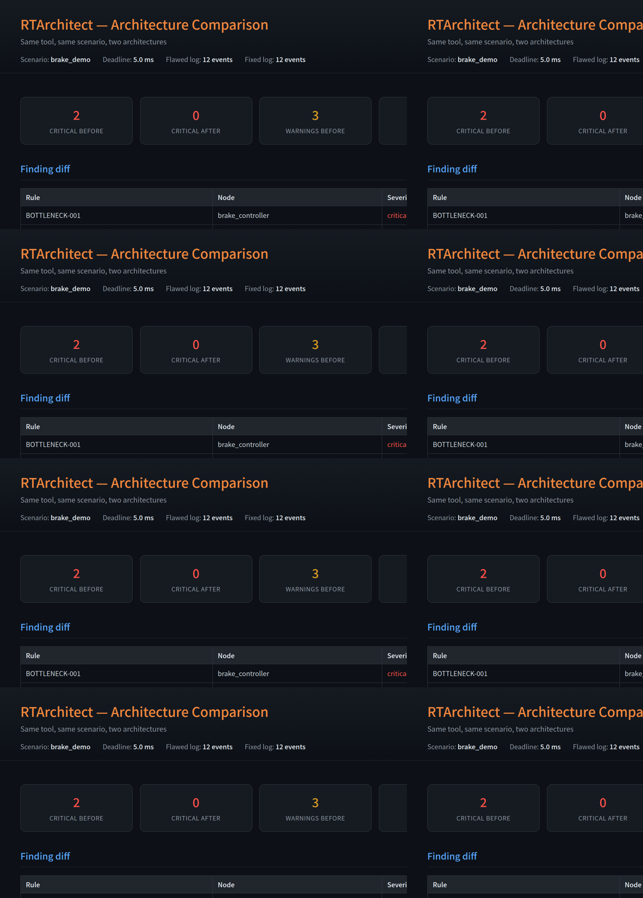
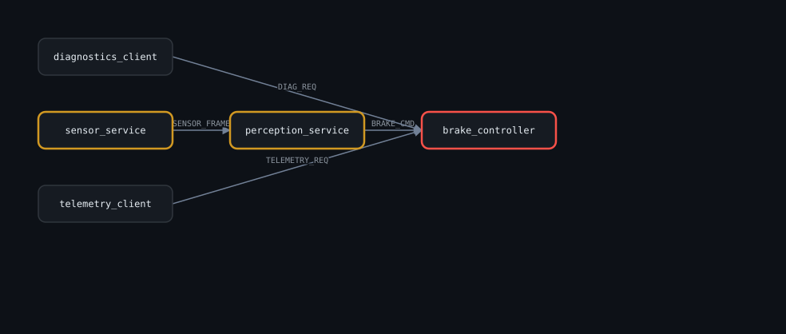

# RTArchitect

[](https://github.com/hybirdvault-dot/rt-architect/actions/workflows/ci.yml)

**Deterministic-first QNX IPC architectural analysis.**

RTArchitect instruments QNX message passing (`MsgSend` / `MsgReceive` /
`MsgReply`), exports structured logs, and turns them into an evidence-backed
architectural analysis: a service interaction graph, real-time latency metrics,
and a deterministic rule engine that flags bottlenecks, priority inversion,
head-of-line blocking, queue-wait dominance and single points of failure.

> **QNX System Profiler is a microscope. RTArchitect is the architect.**

Every finding is produced by a deterministic rule and backed by explicit
evidence (observed values vs. configured thresholds). AI explanation is an
optional later layer — the tool never depends on it.

---

## Status

**Phase 1 — host analysis tool: complete and tested.**

- [x] Parser for the locked `RTARCH` v1 event schema (Threat-4 pre-filter)
- [x] Service interaction graph (NetworkX)
- [x] Node + edge real-time metrics (p50 / p95 / p99)
- [x] Deterministic 5-rule engine, ordered and deduplicated
- [x] Self-contained HTML report with a static SVG service graph
- [x] Typer + Rich CLI
- [x] `pytest` suite — 54 tests
- [x] Three scenarios: `brake_demo` (5 ms), `medical_pump` (2 ms), `industrial_robot` (1 ms)
- [x] Side-by-side comparison report (`rtarch compare`)
- [x] QNX 8.0 target instrumentation (`rtarch_ipc.h`) — API verified against the QNX 8.0 library reference
- [x] Five demo services with the flawed single-threaded `brake_controller`
- [x] Fixed variant: `brake_controller_fixed` (two threads, two named channels)
- [x] Host-side simulation that compiles the real C sources and runs the full pipeline
- [x] Second scenario (`medical_pump`) — same five rules, different topology
- [x] Optional AI explainer + output validator (5 s bound, deterministic fallback)
- [x] QNX prep scripts: QEMU boot, export dry-run, end-to-end smoke test
- [x] Devpost draft, third-party notices, contributing guide
- [ ] Real QNX 8.0 QEMU run — **blocked** (awaiting QNX SDP installer + QEMU BSP + licence)

---

## Quick start

```bash
python3 -m venv .venv
.venv/bin/pip install -e .

# Analyze the flawed demo log
.venv/bin/rtarch tests/golden/synthetic_flawed.log \
  --scenario scenarios/brake_demo.json \
  --output examples/reports/flawed_report.html

# Analyze the fixed demo log
.venv/bin/rtarch tests/golden/synthetic_fixed.log \
  --scenario scenarios/brake_demo_fixed.json \
  --output examples/reports/fixed_report.html
```

Open the generated HTML report in a browser.

### CLI

```
Usage: rtarch [OPTIONS] COMMAND [ARGS]...

Commands:
  analyze   analyse one log and write an HTML report
  compare   put two logs side by side (flawed vs fixed)

rtarch analyze [OPTIONS] LOG_FILE
  --scenario, -s   Scenario config JSON (thresholds, deadline, critical path).
                   [default: scenarios/brake_demo.json]
  --output, -o     Output HTML report path. [default: report.html]
  --ai             Add optional AI explanations. Requires API_BASE_URL and
                   API_KEY; falls back to deterministic templates on failure.

rtarch compare [OPTIONS] FLAWED_LOG FIXED_LOG
  --scenario, -s   Scenario config JSON. [default: scenarios/brake_demo.json]
  --output, -o     Output HTML comparison path. [default: comparison.html]
```

`python -m rtarch analyze …` works identically to the `rtarch` console script.

The AI layer is optional and never required. Without `API_BASE_URL` / `API_KEY`
the tool behaves exactly as it did before the layer existed.

### End-to-end smoke test

```sh
bash scripts/smoke_test_qnx.sh sim    # host simulation, works today
bash scripts/smoke_test_qnx.sh qnx    # real QNX once the SDP + image arrive
```

The smoke test asserts that the flawed log produces at least one critical
finding and that the fixed log clears `BOTTLENECK-001`.

### Before / after comparison

```sh
rtarch compare examples/logs/sim_flawed_slog2.txt \
              examples/logs/sim_fixed_slog2.txt \
              --scenario scenarios/brake_demo.json \
              --output examples/reports/comparison.html
```

A two-column report: findings cleared, p95 deltas, queue-wait deltas, and the
one finding that legitimately remains.

---

## QNX target

The QNX 8.0 C sources live in `target/qnx8_demo/`. They compile against the
real QNX SDP and emit the locked `RTARCH` format through `slog2`.

```
target/
├── qnx8_demo/          # the real QNX 8.0 services
│   ├── include/rtarch_ipc.h
│   ├── sensor_service/  perception_service/  brake_controller/
│   ├── telemetry_client/  diagnostics_client/
│   └── scripts/        # run_flawed_demo.sh, extract_slog2.sh
└── linux_sim/          # host-side simulation of the same sources
    ├── include/        # QNX-compatible slog2 / IPC headers
    ├── shim.c          # condition-variable implementation of QNX IPC
    └── run_sim.sh      # build, run, and analyse
```

### Build for QNX

```sh
source /opt/qnx800/qnxsdp-env.sh
cd target/qnx8_demo
make
```

### Run the host-side simulation (no QNX required)

```sh
bash target/linux_sim/run_sim.sh
```

This compiles the **real** service sources against a QNX compatibility shim,
runs them as threads, writes `examples/logs/sim_flawed_slog2.txt`, and analyses
it. It is a functional simulation — it validates the C sources, the log format
and the pipeline, but it is **not** QNX evidence. See
[docs/qnx_setup.md](docs/qnx_setup.md) for the real QEMU workflow.

---

## Screenshots

| Flawed report — 6 findings | Fixed report — clean |
|---|---|
|  |  |

| Second scenario (`medical_pump`) | Before / after comparison |
|---|---|
|  |  |

| Service interaction graph |
|---|
|  |

More captures live in [`docs/screenshots/`](docs/screenshots/), including the
host-simulation reports, the CLI transcript for both runs, and the project tree.

---

## Architecture

```
QNX 8.0 Target (QEMU)                        Linux Host (Python)
├── sensor_service ──MsgSend──→ perception   ├── parser.py    RTARCH events
├── perception_service ──MsgSend──→ brake    ├── graph.py     NetworkX DiGraph
├── brake_controller (FLAWED)                ├── metrics.py   p50/p95/p99
├── telemetry_client ──MsgSend──→ brake       ├── rules.py     5 deterministic rules
├── diagnostics_client ──MsgSend──→ brake    └── report.py    HTML + SVG graph
│                                            │
└── rtarch_ipc.h (slog2 → RTARCH events)     └── report.html
```

The pipeline is strictly one-directional:

```
raw slog2 → filter RTARCH → parse events → build graph → metrics → rules → report
```

---

## RTARCH event schema (LOCKED)

Every log line starts with `RTARCH` and uses `key=value` pairs:

```
RTARCH v=1 ts_ns=<ns> phase=<SEND|RECV|REPLY> trace_id=<id> msg_id=<id>
       src_pid=<pid> src_name=<service> dst_pid=<pid> dst_name=<service>
       msg_type=<type> prio=<priority>
```

| Field | Purpose |
|---|---|
| `ts_ns` | Nanosecond timestamp from `CLOCK_MONOTONIC` (never slog2's clock) |
| `phase` | `SEND` / `RECV` / `REPLY` — enables queue-wait and processing-time calculation |
| `trace_id` | Follows one request across services |
| `msg_id` | Matches the SEND/RECV/REPLY triple of one request |
| `prio` | QNX thread priority — enables priority-inversion detection |

Latency model:

```
queue_wait = RECV.ts_ns - SEND.ts_ns
processing = REPLY.ts_ns - RECV.ts_ns
total      = REPLY.ts_ns - SEND.ts_ns
```

---

## Rules

| Rule ID | Severity | Condition |
|---|---|---|
| `CRITICAL-PATH-001` | critical | A critical-path service's p95 processing exceeds the deadline |
| `BOTTLENECK-001` | critical | `in_degree > max_in_degree` **and** p95 processing exceeds `deadline × fraction` |
| `HEAD-OF-LINE-001` | warning | High-priority requests blocked **and** low-priority work ratio above threshold |
| `QUEUE-WAIT-001` | warning | p95 queue wait exceeds `queue_wait_ratio` of p95 total latency |
| `SPOF-001` | warning | A critical-path service has `in_degree > spof_min_in_degree` |

Findings are ordered by severity (critical → warning → info), then by node name,
then by rule ID. They are deduplicated by `(rule_id, node)` and numbered
sequentially in display order (`F-001`, `F-002`, ...).

---

## Scenario configuration

All thresholds live in scenario JSON — nothing about a specific service is
hardcoded in the analysis logic. Three scenarios ship in the repo:

| Scenario | Deadline | Critical path | Proves |
|---|---|---|---|
| `brake_demo` | 5 ms | sensor → perception → brake | the demo |
| `medical_pump` | 2 ms | sensor → pump → alarm | a different domain |
| `industrial_robot` | 1 ms | sensor → kinematics → motor | a tighter deadline |

```json
{
  "scenario": "brake_demo",
  "target": "QNX 8.0 QEMU",
  "deadline_ms": 5.0,
  "critical_path": ["sensor_service", "perception_service", "brake_controller"],
  "thresholds": {
    "max_in_degree": 2,
    "processing_deadline_fraction": 0.5,
    "low_priority_work_ratio": 0.4,
    "queue_wait_ratio": 0.5,
    "spof_min_in_degree": 2,
    "priority_threshold": 20,
    "blocked_queue_wait_ratio": 0.2
  }
}
```

`priority_threshold` splits traffic into high/low priority classes.
`blocked_queue_wait_ratio` defines a high-priority block as a queue wait longer
than `deadline_ms × ratio`.

---

## Tests

```bash
.venv/bin/python -m pytest
```

The suite covers the parser (including the RTARCH pre-filter and malformed
lines), metric correctness, all five rules firing on the flawed log, the fixed
log producing zero findings, report generation, and the CLI end-to-end.

Golden logs live in `tests/golden/`.

---

## Project structure

```
rt-architect/
├── target/
│   ├── qnx8_demo/           # QNX 8.0 C services (real target code)
│   └── linux_sim/           # host-side QNX IPC / slog2 simulation
├── rtarch/                  # Python analysis package
│   ├── parser.py            # RTARCH event parsing
│   ├── models.py            # Pydantic models
│   ├── graph.py             # NetworkX service graph
│   ├── metrics.py           # Node + edge metrics
│   ├── rules.py             # Deterministic rule engine
│   ├── report.py            # HTML report + static SVG graph
│   ├── scenario.py          # Scenario config loading
│   ├── cli.py               # Typer + Rich CLI
│   └── templates/
│       └── report.html.j2   # Jinja2 report template
├── scenarios/               # Scenario configs (thresholds, deadline)
├── tests/                   # pytest suite + golden logs
├── examples/                # example logs and generated reports
├── scripts/                 # QEMU boot, export dry-run, smoke test
└── docs/                    # architecture, schema, rules, trust model,
                             #   verification, QNX setup, Devpost draft
```

---

## Threat model

| Threat | Shield |
|---|---|
| Hardcoded toy objection | All config in scenario JSON; zero hardcoded service names |
| slog2 parsing fragility | `RTARCH` pre-filter; malformed lines are skipped, not fatal |
| AI JSON crash | AI layer isolated behind try/except + 5 s timeout + deterministic fallback |
| QNX/QEMU unavailable | Golden synthetic logs exercise the full pipeline on the host |
| Scope creep | Deterministic core ships first; AI is a separate phase |

---

## License

MIT. See [LICENSE](LICENSE).
